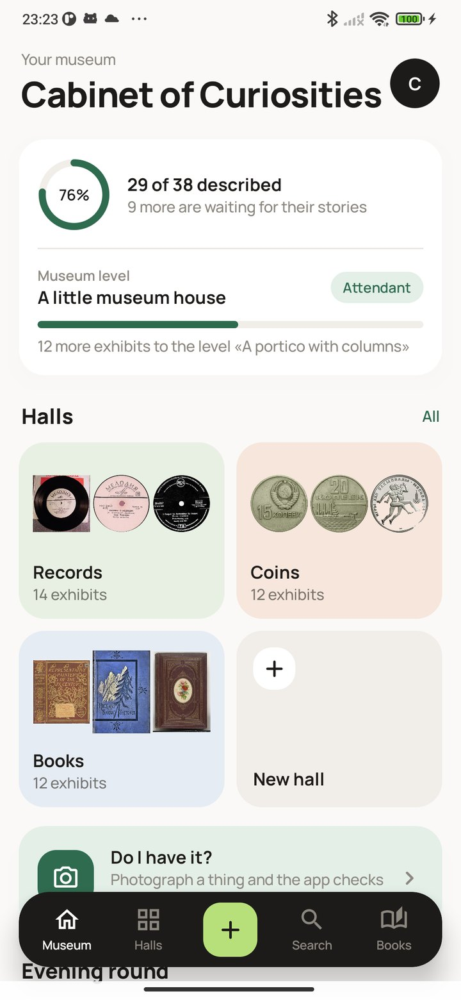
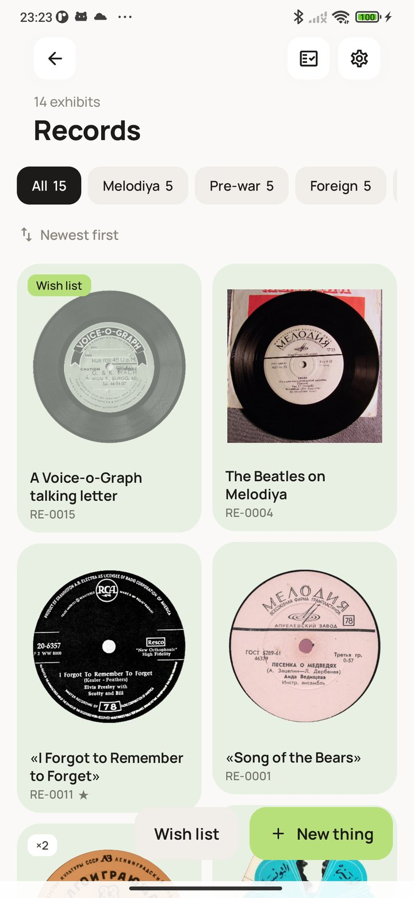
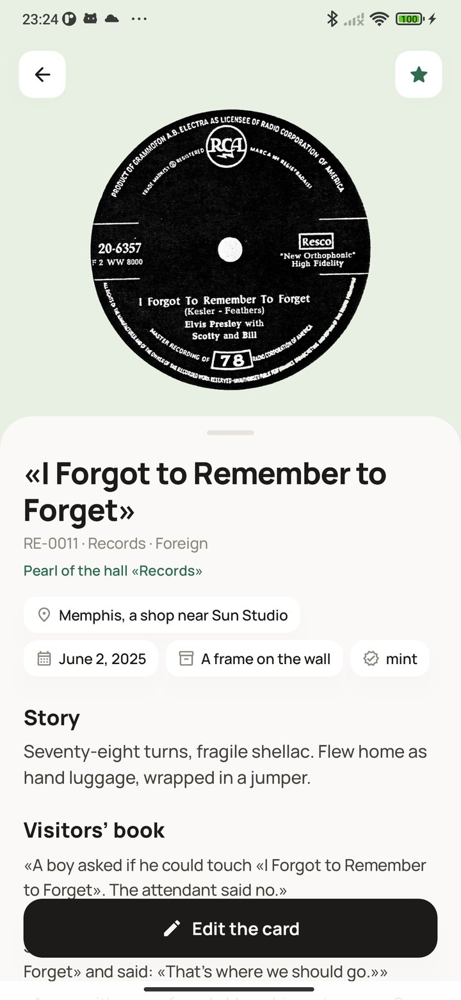
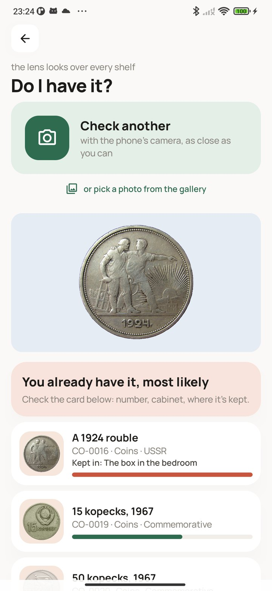

<div align="center">


# Cabinet of Curiosities

### A museum for an odd collection

*Cans, crocodiles, records, coins, fridge magnets: whatever you collect, it gets its own museum, with halls, cabinets, a catalogue and an arrivals book. At a flea market, photograph a thing and the app tells you whether you already have it. Free, no ads, no account, works offline.*

[](https://github.com/bigdevwhale/cabinet/actions/workflows/android.yml)
[](https://github.com/bigdevwhale/cabinet/releases/latest)


[](LICENSE)

**English** · [Русский](README.ru.md) · [Changelog](CHANGELOG.md)

   

**[Download APK](https://github.com/bigdevwhale/cabinet/releases/latest/download/Cabinet.apk)** · Android 9+

</div>

---

## The museum

- **Halls for each collection,** cabinets inside the halls. Records, books, coins, cans, figurines, magnets, stamps and postcards, model cars come with their own card fields (artist and label, denomination and metal, publisher and binding); a hall of your own takes whatever fields you invent.
- **Every thing has a card:** photos, name, inventory number, where it came from, when and for how much, where it is kept, its condition and its story. Things come in one by one through the phone's camera or by the dozen from the gallery; the app cuts the thing out of the background by itself.
- **Things without a story stay faded.** Write where a thing came from or what you remember about it, and it gets its colour back.
- **Series:** «all five coins for the 50th anniversary», with empty places for what is still missing. A wish list and a swap fund for duplicates.

## Is it already on my shelf?

Photograph a thing at a flea market or a fair, and the app compares it with your whole collection: «you already have it, most likely», «there are similar ones» or «you don’t have this», and it tells you when the thing is on your wish list. The comparison runs on the phone. Long-press the app icon to go straight to the check. You can also search by photo from the catalogue.

## What keeps it lively

- **The museum grows** with the collection, from a cabinet in the hall to a museum with a crest; described things raise your rank from keeper of a cabinet to museum director.
- **An evening round:** one question a day about one thing: where it came from, what you remember, where it is kept.
- **The exhibition of the week:** everything red, the old-timers, things from far away; pick the exhibits and get a poster to share.
- **Visitors** come every day and linger at the best described things. «On this day» brings back what arrived in earlier years.
- **A seasonal inventory** with a wax seal, and an arrivals book with every thing in order of acquisition.

Backup to a file, a PDF catalogue and CSV export. Everything stays on the phone: the app has no internet permission. The background cut-out model is downloaded by Google Play services on first use.

## Build

```
./gradlew assembleDebug                 # app.cabinet.dev
./gradlew assembleDebug -Pdemo          # app.cabinet.demo: a museum of records, coins and books
./gradlew testDebugUnitTest             # rules
```

The demo museum shows real records, coins and books from Wikimedia Commons; authors and licences are in [tools/demo/credits.md](tools/demo/credits.md). Image comparison uses the MediaPipe MobileNet V3 image embedder (Apache 2.0), the cut-out uses ML Kit subject segmentation.

MIT licence. Font Manrope (OFL).
