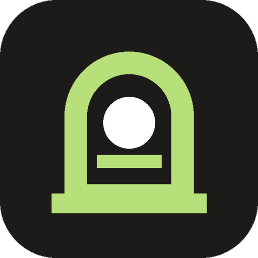
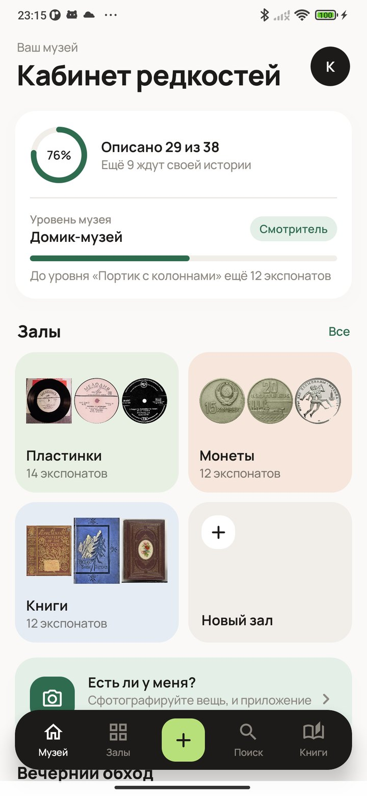
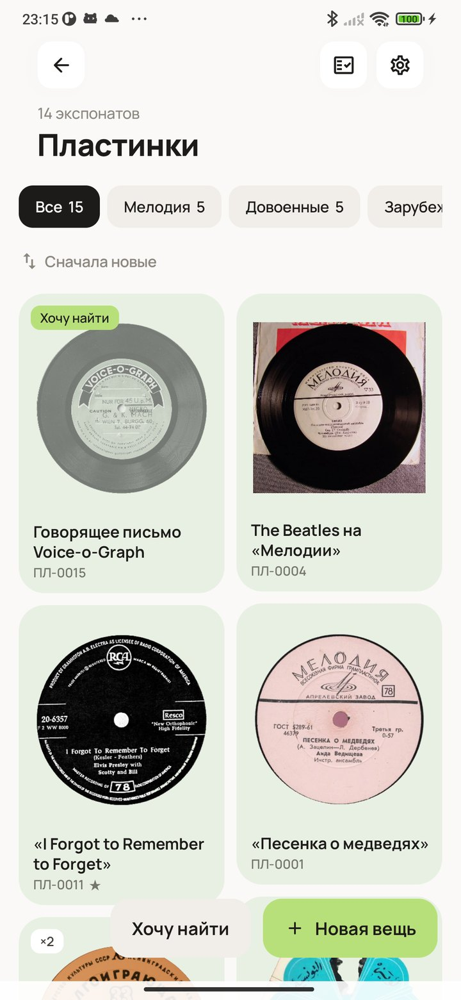
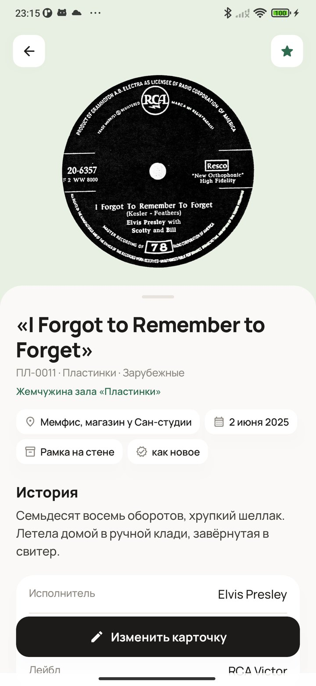
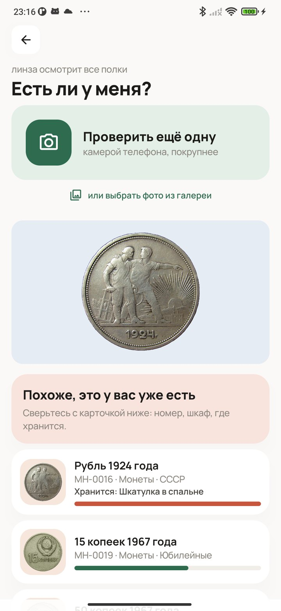

<div align="center">



# Кабинет редкостей

### Музей для необычной коллекции

*Банки, крокодилы, пластинки, монеты, магниты на холодильник: что бы вы ни собирали, у коллекции будет свой музей с залами, шкафами, каталогом и книгой поступлений. На барахолке сфотографируйте вещь, и приложение скажет, есть ли она у вас. Бесплатно, без рекламы и аккаунтов, работает без интернета.*

[](https://github.com/bigdevwhale/cabinet/actions/workflows/android.yml)
[](https://github.com/bigdevwhale/cabinet/releases/latest)


[](LICENSE)

[English](README.md) · **Русский** · [Изменения](CHANGELOG.md)

   

**[Скачать APK](https://github.com/bigdevwhale/cabinet/releases/latest/download/Cabinet.apk)** · Android 9+

</div>

---

## Музей

- **Для каждой коллекции свой зал,** а в залах шкафы. Для пластинок, книг, монет, банок, фигурок, магнитов, марок с открытками и моделей машин уже готовы поля карточки: у пластинки исполнитель и лейбл, у монеты номинал и металл, у книги издательство и переплёт. В своём зале поля можно придумать любые.
- **У каждой вещи есть карточка:** фотографии, название, инвентарный номер, откуда она, когда появилась и сколько стоила, где хранится, в каком состоянии и чем памятна. Вещь можно снять камерой телефона или выбрать из галереи сразу десяток. Фон приложение уберёт само.
- **Вещи без истории остаются бледными.** Допишите, откуда вещь или что вы о ней помните, и к ней вернётся цвет.
- **Серии.** Например, «все пять монет к 50-летию Советской власти»: недостающие места видны сразу. Есть ещё список желаний и обменный фонд для дублей.

## Есть ли у меня?

Сфотографируйте вещь на барахолке или ярмарке, и приложение сравнит её со всей коллекцией. Ответ будет один из трёх: «похоже, это у вас уже есть», «есть похожие» или «такого у вас нет». Если вещь из вашего списка желаний, приложение об этом тоже скажет. Сравнение идёт прямо на телефоне. Чтобы сразу открыть проверку, удерживайте значок приложения. Искать по фото можно и в каталоге.

## Чтобы было интересно

- **Музей растёт** вместе с коллекцией: от шкафа в прихожей до музея с гербом. За описанные вещи растёт звание, от хранителя шкафа до директора музея.
- **Вечерний обход.** Каждый день один вопрос про одну вещь: откуда она, что вы о ней помните, где она лежит.
- **Выставка недели.** Всё красное, старожилы, вещи издалека. Выберите экспонаты, и приложение сделает афишу, которой можно поделиться.
- **Посетители** приходят каждый день и дольше всего стоят у вещей с хорошими описаниями. В разделе «В этот день» видно, что пришло в коллекцию в прошлые годы.
- **Инвентаризация** раз в сезон, с сургучной печатью. В книге поступлений все вещи записаны в том порядке, в каком появились.

Можно сохранить резервную копию в файл, выгрузить каталог в PDF или таблицу в CSV. Всё хранится на телефоне, разрешения на интернет у приложения нет. Модель, которая убирает фон, при первом запуске скачивают сервисы Google Play.

## Сборка

```
./gradlew assembleDebug                 # app.cabinet.dev
./gradlew assembleDebug -Pdemo          # app.cabinet.demo: музей пластинок, монет и книг
./gradlew testDebugUnitTest             # правила
```

В демо-музее настоящие пластинки, монеты и книги с Викисклада. Авторы снимков и лицензии перечислены в [tools/demo/credits.md](tools/demo/credits.md). Фотографии сравнивает модель MediaPipe MobileNet V3 (Apache 2.0), фон убирает ML Kit.

Лицензия MIT. Шрифт Manrope (OFL).
